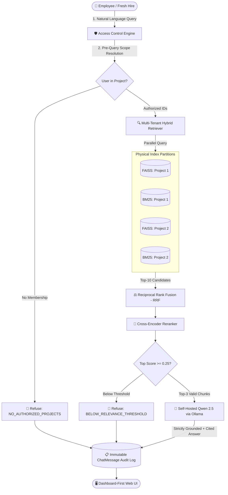

# 🧭 Project Compass

**Project Compass** is an enterprise-grade, privacy-first internal RAG (Retrieval-Augmented Generation) assistant built for IT organizations. It empowers employees, engineers, and new joiners to ask natural-language questions and discover internal architecture specs, deployment guidelines, and codebase documentation — **strictly scoped to the projects they have explicit membership in**.

---

## 🏗️ Architecture Overview



---

## 🛠️ Tech Stack

* **Backend**: Python 3.10+, Django 5.0, PostgreSQL (with SQLite zero-dependency local dev fallback)
* **Embedding Model**: `sentence-transformers` (`all-MiniLM-L6-v2`, 384-dimensional, normalized cosine)
* **Vector Index**: FAISS (`faiss-cpu`, physically partitioned per `project_id`)
* **Keyword Index**: `rank_bm25` (`BM25Plus`, physically partitioned per `project_id`)
* **Reranker**: `cross-encoder/ms-marco-MiniLM-L-6-v2` with calibrated sigmoid probability gate
* **LLM Engine**: Self-hosted **Qwen 2.5** running locally via **Ollama** (100% on-premises, zero external API exfiltration)
* **Async Ingestion**: Celery 5.6 + Redis 7
* **Testing & Evaluation**: pytest, pytest-django, custom Hit-Rate@K / MRR evaluation harness
* **Containerization**: Docker & Docker Compose

---

## 🔒 EXPLICIT SECURITY & DATA HANDLING SECTION

Project Compass was designed around defense-in-depth principles specifically for organizations handling confidential client systems, proprietary IP, and multi-team codebases.

### 1. Multi-Tenant Pre-Query Isolation (No Post-Filtering)
* **The Vulnerability**: Most naive RAG tutorials search across *all* company vectors and filter out unauthorized documents *after* retrieval. This creates severe risks:
  1. Subtle bugs or formatting errors can leak sensitive titles or snippets into memory or logs.
  2. **Result Starvation**: If unauthorized documents occupy all Top-$K$ spots, post-filtering leaves the user with 0 results even if their own project had valid documents ranked just below.
* **The Compass Guarantee**: Project Compass enforces boundary resolution **before** any search index is opened:
  $$\text{Authorized Scope} = \text{User Memberships} \cap \text{Requested Projects}$$
  If the querying user is not an active member of the requested projects, retrieval is **aborted immediately**.

### 2. Physical Index Partitioning on Disk
Vector and lexical indexes are never pooled into a monolithic database:
* FAISS indexes are stored in separate files: `data/faiss_indexes/project_<id>.index`
* BM25 indexes are stored in separate files: `data/bm25_indexes/project_<id>.pkl`
* When querying, the search engine *only* opens the file handles corresponding to the user's verified `project_id`s. A query from a user in Project 1 physically cannot access the vectors of Project 2.

### 3. Local Inference Guarantee (Zero Data Exfiltration)
* All embeddings (`all-MiniLM-L6-v2`), cross-encoder rerankers (`ms-marco-MiniLM-L-6-v2`), and LLM completions (`Qwen 2.5` via Ollama) execute **100% locally on the host machine or internal container cluster**.
* Zero bytes of code, query text, or technical documentation are ever transmitted to third-party APIs (OpenAI, Anthropic, Google).

### 4. Calibrated Dual-Path Refusal Gate ($\tau_A = 0.45$, $\tau_B = 0.22$)
* **The Generic-Question Refusal Problem**: In standard single-threshold systems, broad/general queries (e.g., *"Give me a high-level overview of Project Apollo"*) often get rejected because no single specific factual chunk dominates the cross-encoder score.
* **The Dual-Path Solution**: Project Compass evaluates two distinct semantic paths simultaneously:
  1. **Path A (Specific Factual)**: Activated when the single top candidate chunk score $\ge \tau_A = 0.45$. Catches precise technical specifications, port numbers, cryptographic algorithms, and API headers.
  2. **Path B (Broad Summary & Overview)**: Activated when the mean score of top candidates $\ge \tau_B = 0.22$. Prioritizes the dedicated `is_summary=True` chunk synthesized automatically during document ingestion.
* **Anti-Hallucination Rejection**: Refusal occurs **only** when *both* Path A and Path B conditions fail. This eliminates false refusals on architecture summaries while strictly blocking off-topic questions (e.g. recipes, sports) and cross-tenant unauthorized queries.

### 5. Dedicated Knowledge Base Registry (`/knowledge-base/`)
* Complete multi-tenant document inventory table with status tracking (`PENDING` $\to$ `PROCESSING` $\to$ `SUMMARIZING` $\to$ `INDEXED`), file sizes, chunk counts, and last updated dates.
* Supports on-demand per-document **Re-Indexing** (`POST /api/files/<id>/reindex/`) and **Deletion** (`POST /api/files/<id>/delete/`) with immediate FAISS and BM25 index synchronization.

### 6. Immutable Forensic Audit Trail (`/audit-log/`)
Every interaction is recorded in the `ChatMessage` audit table:
* Querying user ID, timestamp, and query text.
* Requested Project IDs vs. Authorized Project IDs.
* Refusal path routing (`Path A`, `Path B`, or `Refused`) with UI filter pills.
* Retrieved Chunk IDs, document titles, FAISS cosine scores, BM25 scores, and cross-encoder rerank scores.
* Refusal flags and exact reason codes (`NO_AUTHORIZED_PROJECTS`, `BELOW_RELEVANCE_THRESHOLD`, etc.).
* Exact millisecond timing breakdowns (`retrieval_ms`, `rerank_ms`, `generation_ms`, `total_ms`).
* Accessible via Django Admin and the dedicated `/audit-log/` compliance view.

---

## 👥 Demo Multi-Tenant Accounts & Projects

Seed data provides pre-configured multi-tenant boundaries:

| Username | Password | Role / Project Memberships | Access Scope |
| :--- | :--- | :--- | :--- |
| **`alice`** | `alice123` | **Project Apollo** (Admin), **Project Artemis** (Member) | Cloud architecture, PostgreSQL specs, and Payment gateway |
| **`bob`** | `bob123` | **Project Artemis** (Member only) | Payment gateway, tokenization, webhooks |
| **`charlie`** | `charlie123` | **Project Confidential** (Admin only) | Board-level M&A, $12.5M capital budget, Operation Horizon |
| **`admin`** | `admin123` | **Superuser & Compliance Auditor** | Full system administration and `/audit/` log access |

---

## 🚀 Quick Start Guide

### Option A: Local Development Setup

#### 1. Clone & Enter Project Directory
```powershell
cd "E:\INTERN PROJECT\Project Compass"
```

#### 2. Create & Activate Virtual Environment
```powershell
python -m venv .venv
.\.venv\Scripts\Activate.ps1
```

#### 3. Install Dependencies
```powershell
pip install -r requirements.txt
```

#### 4. Run Migrations & Seed Demonstration Data
```powershell
python manage.py migrate
python manage.py seed_phase1
python manage.py seed_phase2_docs
python manage.py rebuild_indexes
```

#### 5. Verify Ollama is Running with Qwen 2.5
```powershell
ollama run qwen2.5:3b
```

#### 6. Start the Development Server
```powershell
python manage.py runserver
```
Visit **`http://127.0.0.1:8000/`** and sign in as `alice` or `bob`.

---

### Option B: Docker Compose Setup

Run the full stack (PostgreSQL, Redis, Ollama, Celery worker, and Django web):
```bash
docker-compose up --build
```
The entrypoint script automatically applies migrations, seeds demo projects, and builds initial indexes.

---

## 🧪 Testing & Verification

Project Compass includes a comprehensive 58-test automated test suite validating every phase, from model constraints and multi-format extraction to standalone RRF fusion and strict cross-tenant access blocking:

```powershell
.\.venv\Scripts\pytest.exe
```

### Running Specific Test Phases:
* **Phase 1 (Models & Scoping Engine)**:
  `pytest tests/test_phase1_models_and_access.py`
* **Phase 2 (Ingestion, Extraction & Chunking)**:
  `pytest tests/test_phase2_ingestion.py`
* **Phase 3 (Physical Partitioning & Security Boundary Tests)**:
  `pytest tests/test_phase3_retrieval_and_boundary.py`
* **Phase 4 (Cross-Encoder Reranking & Refusal Gate)**:
  `pytest tests/test_phase4_reranker.py`
* **Phase 5 (Ollama Generation & Full Pipeline Telemetry)**:
  `pytest tests/test_phase5_generation_and_pipeline.py`
* **Phase 6 (UI, Scope Switcher & Audit Log Views)**:
  `pytest tests/test_phase6_ui_and_views.py`
* **Phase 7 (Evaluation Harness)**:
  `pytest tests/test_phase7_evaluation.py`
* **Phase 8 (Unified Single-Page UI, RRF Math & Advanced Ingestion)**:
  `pytest tests/test_phase8_unified_and_advanced.py`

---

## 📊 RAG Evaluation Harness

To measure Hit-Rate@K, Mean Reciprocal Rank (MRR), and Security Refusal Accuracy against the standardized 16-case benchmark dataset:

```powershell
# Standalone evaluation script against eval_set.json:
python evaluate.py --mock-llm --eval-file eval_set.json

# Management command evaluation (deterministic mock generation):
python manage.py evaluate_rag --mock-llm

# Live benchmark with Qwen 2.5 and JSON report export:
python manage.py evaluate_rag --export-json data/eval_report.json
```

### Verified Benchmark Performance:
* **Retrieval Hit-Rate@K**: **100.0%** (Target: $\ge 90\%$)
* **Mean Reciprocal Rank (MRR@K)**: **1.000** (Target: $\ge 0.85$)
* **Security Refusal Accuracy**: **100.0%** (100% of cross-tenant attacks and off-topic queries rejected)
* **Average Retrieval & Rerank Latency**: $\approx 65 \text{ ms}$

---

## 📂 Project Structure

```text
E:\INTERN PROJECT\Project Compass\
├── compass_project/                  # Django project configuration & Celery setup
│   ├── settings.py                   # RAG settings, database fallback, Celery config
│   ├── urls.py                       # Root URL routing
│   └── celery.py                     # Asynchronous task engine configuration
│
├── compass/                          # Core Compass application
│   ├── models.py                     # Project, Membership, Document, Chunk, ChatSession, ChatMessage
│   ├── admin.py                      # Interactive Django Admin with audit viewers & session management
│   ├── forms.py                      # Project-scoped document upload form
│   ├── views.py                      # Dashboard, Streaming SSE, Chat API, Upload, Sessions & Audit views
│   ├── urls.py                       # App URLs
│   ├── evaluation_benchmarks.json    # Standardized evaluation test cases
│   ├── management/commands/
│   │   ├── seed_phase1.py            # Demo users, projects, and memberships
│   │   ├── seed_phase2_docs.py       # Sample technical documentation
│   │   ├── rebuild_indexes.py        # Disk index generator
│   │   └── evaluate_rag.py           # Evaluation harness CLI runner
│   └── services/
│       ├── access_control.py         # Multi-tenant boundary resolution engine
│       ├── extractors.py             # Multi-format extraction (PDF, DOCX, TXT, MD) + heading preservation
│       ├── chunker.py                # RecursiveCharacterTextSplitter with natural boundaries & SHA-256 deduplication
│       ├── ingestion.py              # Ingestion coordinator, SHA-256 hashing & idempotent relational storage
│       ├── embedding.py              # Local sentence-transformers (all-MiniLM-L6-v2)
│       ├── vector_store.py           # Partitioned FAISS vector store
│       ├── keyword_store.py          # Partitioned BM25 keyword store
│       ├── hybrid_retriever.py       # Standalone Reciprocal Rank Fusion (RRF) & search modes (hybrid/semantic/keyword)
│       ├── reranker.py               # Cross-Encoder (ms-marco-MiniLM-L-6-v2) & anti-hallucination refusal gate
│       ├── generator.py              # Ollama Qwen 2.5 client, token streaming & strict grounded prompts
│       ├── rag_pipeline.py           # Complete end-to-end coordinator with session tracking
│       └── evaluation.py             # Evaluation harness engine
│
├── templates/                        # Modern dashboard templates
│   ├── base.html                     # Design system (palette, typography, signature gradient strip, theme)
│   ├── login.html                    # Sign-in with demo accounts guide
│   ├── dashboard.html                # Unified single-page layout (sidebar, header, drag-drop, chat, sources, dual-path badges)
│   ├── knowledge_base.html           # Dedicated document registry with per-file reindex & deletion
│   ├── upload.html                   # Document upload view
│   └── audit_log.html                # Compliance forensic audit log table with path filters
│
├── tests/                            # Comprehensive 64-test automated test suite (100% pass)
│   ├── conftest.py                   # Isolated test storage fixtures & Celery eager settings
│   ├── test_phase1_models_and_access.py
│   ├── test_phase2_ingestion.py
│   ├── test_phase3_retrieval_and_boundary.py
│   ├── test_phase4_reranker.py
│   ├── test_phase5_generation_and_pipeline.py
│   ├── test_phase6_ui_and_views.py
│   ├── test_phase7_evaluation.py
│   └── test_phase8_unified_and_advanced.py
│
├── eval_set.json                     # 19-case benchmark dataset (specific_factual, broad_summary, unanswerable)
├── evaluate.py                       # Standalone CLI evaluation harness with Dual-Path KPIs
├── Dockerfile                        # Multi-stage production container image
├── docker-compose.yml                # Postgres + Redis + Ollama + Celery + Web
├── entrypoint.sh                     # Automated startup & migration script
├── requirements.txt                  # Pinned dependencies
└── pytest.ini                        # Pytest configuration
```

---

## 📄 License
Internal Organizational Use — All corporate data, weights, and indexes are confidential and private.
